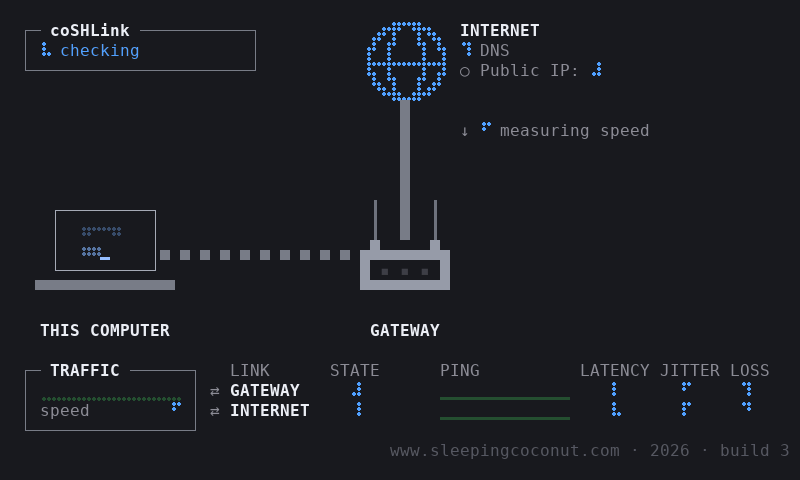

# coSHLink

A live map of the network path from this computer to the internet, drawn in
an 80x24 terminal.

<p align="center">
  
</p>

coSHLink draws this computer, the gateway and the internet as a diagram. Each
link pulses in green, amber or red while it is up, degraded or down, and the
link to the gateway is dashed over Wi-Fi and solid over a cable. A panel lists
the traffic, latency, jitter and loss of each link. Around the map you see the
Wi-Fi network, the local and gateway addresses, the state of the DNS, the
public IP address with its location and operator, a possible carrier-grade
NAT and the download speed.

It is a single bash script. It installs nothing and needs no administrator
rights.

## Download

In a terminal, in the folder where you want it:

```sh
curl -fsSL https://raw.githubusercontent.com/lolostt/coSHLink/main/coSHLink.sh -o coSHLink.sh && chmod +x coSHLink.sh
```

- 🍎 **macOS** and 🐧 **Linux**: any terminal.
- 🪟 **Windows**: Git Bash (see [Requirements](#requirements)).

## Three ways to run it

### 1. Run the script

```sh
./coSHLink.sh -l
```

Press `q` or `Ctrl+C` to quit. Without `-l` it stops after 60 seconds.

### 2. Install it as a command

```sh
./coSHLink.sh -i
```

Then, in a new terminal and from any folder:

```sh
coshlink -l
```

The installer copies the script to `~/.local/bin/coshlink` and, if that
folder is not in your `PATH`, adds one marked line to `~/.zshrc`,
`~/.bash_profile` or `~/.bashrc`, depending on your shell.

- 🍎 **macOS**: on macOS 15 and later it offers to run
  `sudo ipconfig setverbose 1`, so that the Wi-Fi name is shown (see
  [Wi-Fi name on macOS](#wi-fi-name-on-macos)).
- 🪟 **Windows**: run `./coSHLink.sh -i` in Git Bash. It also writes
  `coshlink.cmd` to `%LOCALAPPDATA%\Microsoft\WindowsApps`, so `coshlink -l`
  works in PowerShell and cmd too.

To update it to the latest version on GitHub:

```sh
coshlink -u
```

To uninstall it (this removes only what `-i` added):

```sh
coshlink -r
```

### 3. Double-click a launcher

Download the launcher for your system into the same folder as `coSHLink.sh`,
then double-click it. It opens an 80x24 window running `coSHLink.sh -l`.

- 🍎 **macOS**:

  ```sh
  curl -fsSL https://raw.githubusercontent.com/lolostt/coSHLink/main/coSHLink.command -o coSHLink.command && chmod +x coSHLink.command
  ```

- 🪟 **Windows** (in Git Bash):

  ```sh
  curl -fsSL https://raw.githubusercontent.com/lolostt/coSHLink/main/coSHLink.bat -o coSHLink.bat
  ```

- 🐧 **Linux**:

  ```sh
  curl -fsSL https://raw.githubusercontent.com/lolostt/coSHLink/main/coSHLink.desktop -o coSHLink.desktop && chmod +x coSHLink.desktop
  ```

  The first time, GNOME Files asks you to allow it (right click, "Allow
  Launching").

## Options

| Short | Long          | What it does                                                    |
|-------|---------------|-----------------------------------------------------------------|
| `-l`  | `--loop`      | Run until `q` or `Ctrl+C`.                                      |
| `-n`  | `--no-speed`  | Do not measure the download speed (see below).                  |
| `-c`  | `--check`     | Read every source once, print the results and exit.             |
| `-L`  | `--log FILE`  | Append the errors of the background measurements to `FILE`.     |
| `-8`  | `--256`       | Use 256 colours.                                                |
| `-t`  | `--truecolor` | Use 24-bit colour.                                              |
| `-i`  | `--install`   | Install it as the command `coshlink`.                           |
| `-u`  | `--update`    | Download the latest version from GitHub and install it.         |
| `-r`  | `--uninstall` | Remove what `--install` added.                                  |
| `-v`  | `--version`   | Print the version.                                              |
| `-h`  | `--help`      | Print the help.                                                 |

Short options can be combined: `-ln` is `-l -n`. The thresholds, ping targets
and intervals are in the *User configuration* section at the top of the
script.

By default the download speed is measured every 10 minutes, and each test
downloads 25 MB: about 150 MB an hour while it runs. On a metered connection,
use `-n`.

## Wi-Fi name on macOS

🍎 macOS 15 and later hide the Wi-Fi name from scripts, and coSHLink then
shows it as "(name hidden)". To show it to every program, across reboots:

```sh
sudo ipconfig setverbose 1
```

To hide it again:

```sh
sudo ipconfig setverbose 0
```

## Requirements

| System        | Minimum                                             | Needs                                                         |
|---------------|-----------------------------------------------------|---------------------------------------------------------------|
| 🍎 macOS      | macOS 12 Monterey                                   | Nothing: everything it uses ships with macOS.                 |
| 🐧 Linux      | bash 5 (Ubuntu 20.04, Debian 10, Fedora 30, RHEL 9) | `iproute2`, `ping`, `curl`, `nslookup`, `iconv`, `traceroute` |
| 🪟 Windows    | Windows 10                                          | [Git for Windows](https://gitforwindows.org/), which brings Git Bash. [Windows Terminal](https://learn.microsoft.com/windows/terminal/) is used if it is installed. |

- 🍎 **macOS.** The script runs on the bash 3.2 that macOS ships, and then
  uses `perl` (also built in) to pace the frames. Every tool it calls
  (`curl`, `ping`, `nslookup`, `traceroute`, `netstat`, `ipconfig`,
  `networksetup`, `system_profiler`) has been part of macOS for many years.
  The Wi-Fi details come from `system_profiler` and `ipconfig getsummary`,
  whose output Apple changes from time to time. macOS 12 is the oldest
  version whose output format the script expects. Older versions may still
  run, but with an empty Wi-Fi box. Terminal shows 24-bit colour from macOS
  26; before that it uses 256 colours.
- 🐧 **Linux.** Before it starts, the script checks that every tool is
  there. If one is missing, it names the packages to install (for `apt-get`,
  `dnf`, `yum`, `zypper`, `pacman` or `apk`) and exits. With bash 5.0 or
  later, the frames are paced and timed with bash alone. With bash 3.2 or 4,
  `perl` is needed for smooth animation (without it the animation still
  runs, but less evenly). On minimal installations, `nslookup` comes in
  `dnsutils` (Debian, Ubuntu) or `bind-utils` (Fedora, RHEL), and
  `traceroute` in its own package. The Wi-Fi box shows "no details on
  Linux".
- 🪟 **Windows.** Git for Windows ships bash 5. Windows Terminal needs
  Windows 10 version 2004 or later; without it the launcher uses mintty,
  which comes with Git.

Run `./coSHLink.sh -c` to see which tools are missing on your computer.

## How it works

The measurements run in background processes, so the drawing never waits for
the network. They write their results to a private temporary directory that
only your user can open, and that is removed on exit. On Linux it is in
`/dev/shm`, in memory, unless `TMPDIR` is set.

## Privacy

To show the public IP with its place and operator, coSHLink asks
[ipinfo.io](https://ipinfo.io) every 5 minutes and whenever the network
changes, so that service learns roughly where the computer is.
[api.ipify.org](https://www.ipify.org) is asked only if ipinfo.io fails.
Each speed test downloads from `speed.cloudflare.com`, unless you use `-n`.
Nothing else leaves the computer.

## License

MIT. See [LICENSE](LICENSE).

---

<p align="center">
  <a href="https://github.com/lolostt/coSHLink"></a>
  <br>
  <a href="https://sleepingcoconut.com">www.sleepingcoconut.com</a> · 2026
</p>
